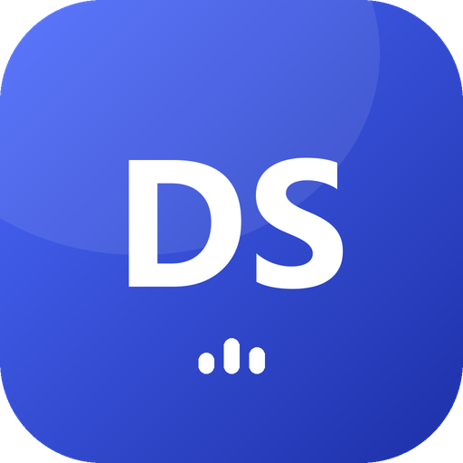
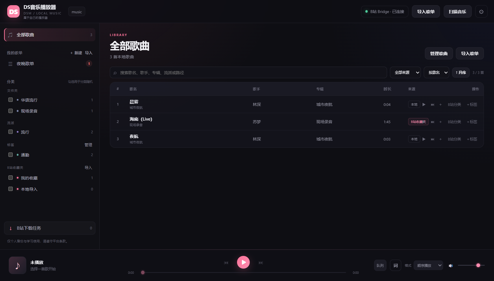

<p align="center">
  
</p>

<h1 align="center">DS音乐播放器（DSM）</h1>

<p align="center"><strong>属于自己的播放器</strong></p>

<p align="center">
  Windows 本地音乐播放器 + B站收藏夹音频下载工具
</p>

---

## 简介

DS音乐播放器（缩写 **DSM**）是一个面向 Windows 10/11 的本地音乐播放器。

它把本地音乐库、第三方歌单匹配、B站收藏夹下载、桌面歌词和常用播放控制放在同一个应用里；数据保存在本机 SQLite 数据库中，不需要注册账号，也不会上传你的音乐文件。

这个项目不追求把所有功能都塞进官方版本。基础功能保持稳定，个性化需求可以按需修改源码，做成真正属于自己的播放器。

## 界面预览



- [歌单状态筛选与手动匹配](docs/screenshots/02-playlist-match.png)
- [导入本地歌曲到 B站收藏夹](docs/screenshots/03-bili-import.png)

更多截图和完整图文介绍见：[docs/功能介绍.md](docs/功能介绍.md)

## 功能

### 音乐库

- 扫描本地音乐文件夹，读取标题、歌手、专辑、时长和流派
- 搜索歌名、歌手、专辑、流派和路径
- 按来源筛选：全部 / 本地 / B站收藏夹
- 按歌名、歌手、专辑、时长排序
- 歌曲批量删除、同时删除磁盘文件、移动到音乐文件夹内的目录

### 歌单与标签

- 导入 M3U / M3U8 / CSV / JSON 歌单
- 兼容无表头的 `歌曲名：…，歌手名：…，专辑名：…` 单行歌单文本
- 按路径或“标题 + 歌手 + 时长”匹配本地歌曲
- 已下载 / 缺失 / 疑似状态筛选，缺失标红，CSV 导出
- 重新检测歌单；扫描本地音乐后自动重新匹配
- 手动选择本地歌曲匹配，手动匹配不会被自动检测覆盖
- 新建、重命名、删除歌单；从歌单移除条目
- 添加、批量添加、重命名和删除自定义标签

### 播放

- 顺序播放、单曲循环、列表随机、分类内随机、跨分类随机
- 播放队列、下一首播放、队列内切换/移除/清空后续
- 桌面悬浮歌词：置顶、拖动、字号调整、LRC 自动读取与手动选择
- 播放/暂停按钮使用矢量图标

### B站收藏夹

- 通过浏览器插件发送收藏夹下载任务
- DASH 音频 m4a 直接下载，不强制转码
- 任务进度、跳过、失败明细、失败重试、任务取消
- 自定义 B站下载文件夹
- 把本地歌曲导入 B站收藏夹分类，不新建歌单
- 手动把歌曲移动到 B站收藏夹分类
- 预留其他视频网站收藏夹的导入接口

### 系统集成

- 系统托盘：显示/隐藏窗口、播放控制、桌面歌词、退出
- Windows 媒体键 / 系统媒体控制（SMTC）
- 关闭窗口时可最小化到托盘，音乐继续播放

### 外观

- 经典 / 日间 / 夜间 / 自定义主题
- 强调色和背景色自定义
- 主题记忆，桌面歌词同步换色
- 左上角标识：`DSM / LOCAL MUSIC` · `属于自己的播放器`

## 下载

前往 [GitHub Releases](https://github.com/tan90114514/DeepseekMusic/releases/latest) 下载最新版本。

推荐文件：

| 文件 | 说明 |
| --- | --- |
| `DSM-0.10.0-Portable-win-x64.zip` | 免安装便携版，解压后运行 |
| `DSM-0.10.0-Windows-x64.zip` | 便携版 + 安装版 + 插件 + 文档 |
| `DSM-0.10.0-Setup.exe` | 安装版，需要管理员权限 |

安装包没有代码签名，Windows SmartScreen 可能提示“未知发布者”。确认文件来源可信后，点“更多信息 → 仍要运行”。

## 快速开始

1. 解压 ZIP 到固定文件夹，不要只把 exe 拖出来。
2. 双击 `DSM-0.10.0-Portable.exe` 或安装后的 `DSM.exe`。
3. 首次启动选择音乐文件夹，软件会自动扫描。
4. 需要导入歌单时，点顶部“导入歌单”。
5. 需要下载 B站收藏夹时，按下面的插件步骤配置。

## B站插件

1. 打开软件右上角设置 → B站 Bridge。
2. 生成并复制 Token。
3. 在 Chrome/Edge 打开 `edge://extensions` 或 `chrome://extensions`。
4. 开启“开发人员模式”，选择“加载解压缩的扩展”。
5. 选择软件目录中的 `extension` 文件夹。
6. 打开 B站收藏夹详情页，点插件图标，填写端口 `39547` 和 Token。
7. 发送任务；下载发生在本机，插件只负责发起请求。

## 技术栈

- Electron
- React
- TypeScript
- Vite / electron-vite
- SQLite（sql.js，无需原生编译）
- electron-builder
- Manifest V3 浏览器扩展

## 本地开发

需要 Node.js 20+、npm 和 Windows x64。

```bash
npm install
npm run dev
npm run typecheck
npm run build
npm run dist
```

构建产物在 `dist/` 目录。

详细开发说明见 [README-DETAILED.md](README-DETAILED.md)、[DEVELOPMENT.md](DEVELOPMENT.md) 和 [NOTICE.md](NOTICE.md)。

## 数据位置

- 升级安装：`%APPDATA%\LocalMusicPlayer`
- 全新安装：`%APPDATA%\DSM`

卸载软件不会自动删除数据库、歌单和 Token。需要彻底清理时请手动备份/删除该目录。

## 已知限制

- 不提供 MP3 转码；B站音频保存为 m4a。
- 歌词只支持本地 LRC 或手动选择，不联网搜索。
- 自动歌单匹配依赖歌名、歌手和时长；编码损坏时请手动“匹配”。
- 移动歌曲只支持当前音乐文件夹内。
- 删除歌曲不会自动删除同名 `.lrc`。
- B站多 P 视频只处理第 1 P。
- 安装包和便携版未做代码签名。
- 其他视频网站目前只有导入接口，没有实际实现。

## 开发信息

- 原始主要开发：**DeepSeek（AI 协作开发）**
- 项目发起 / 维护：**tan90114514**
- GitHub：https://github.com/tan90114514
- AI 工具：DeepSeek
- 开发时间：2026
- 许可证：MIT

衍生版本请保留 [DEVELOPMENT.md](DEVELOPMENT.md) 和 [NOTICE.md](NOTICE.md)，并在开发记录中补充基于版本、开发者、AI 工具、开发时间和修改内容。

## 免责声明

本软件与哔哩哔哩无关联，仅用于个人备份与学习。请遵守平台条款，不要公开传播下载内容，不要绕过付费或受限内容。

音乐、封面和第三方内容的版权归各自权利人所有。
