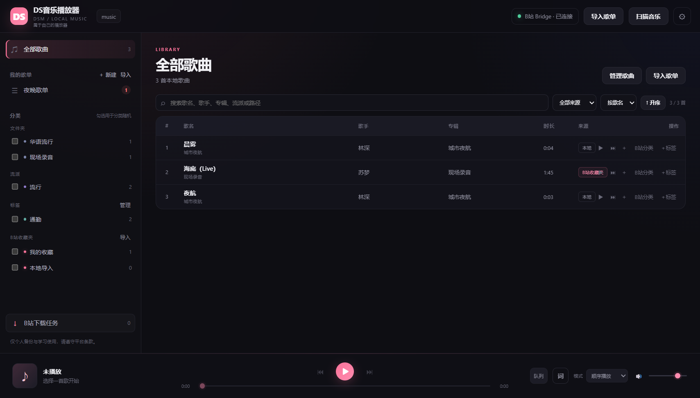
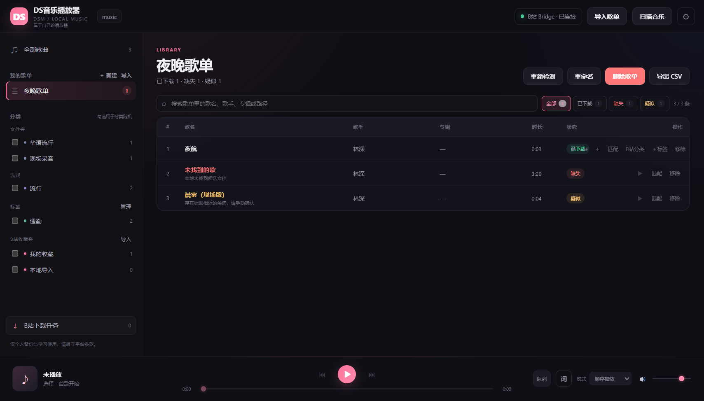
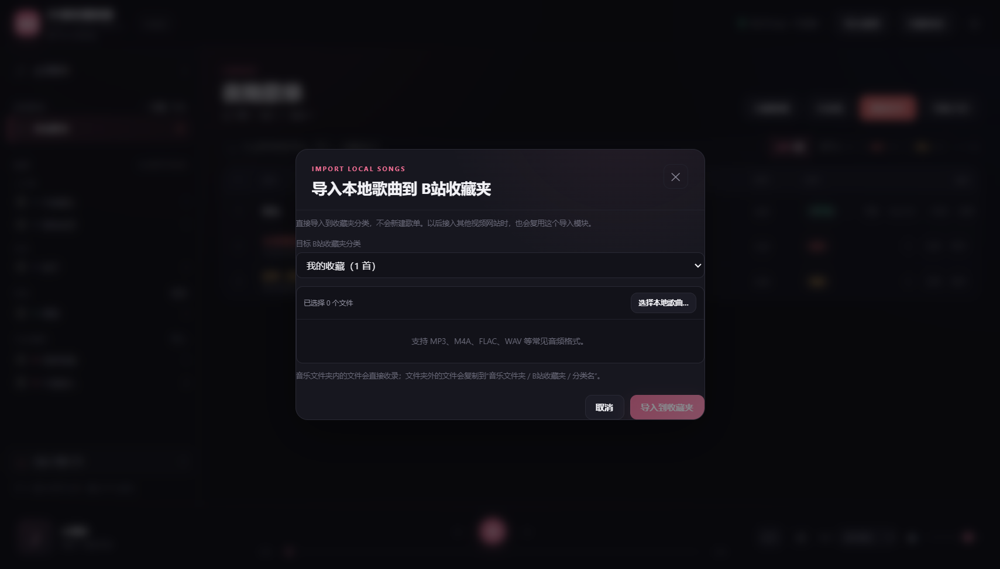

# DSM 功能介绍（图文）

> DS音乐播放器 · 属于自己的播放器  
> 当前版本：0.10.0  
> 以下截图使用演示数据，不包含真实用户音乐。



## 一、定位

DS音乐播放器（DSM）是一个 Windows 本地音乐播放器，同时支持把 B站收藏夹里的音频下载到本地。

它不是在线音乐平台，不提供歌曲搜索下载，也不会上传你的音乐文件。软件负责管理你自己的本地音乐、歌单、标签和收藏夹。

基础功能保持简单稳定，个性化需求可以通过修改源码实现。

## 二、本地音乐库

主界面集中展示：

- 左侧：全部歌曲、歌单、文件夹、流派、标签、B站收藏夹
- 中间：歌曲列表，显示歌名、歌手、专辑、时长和来源
- 底部：播放器、进度、音量、播放模式和队列
- 顶部：导入歌单、扫描音乐、设置

支持：

- 扫描本地音乐文件夹
- 读取标题、歌手、专辑、时长和流派
- 按歌名、歌手、专辑、流派、路径搜索
- 按来源筛选：全部 / 本地 / B站收藏夹
- 按歌名、歌手、专辑、时长排序
- 批量删除、同时删除磁盘文件、移动到音乐文件夹内目录

## 三、歌单检测与手动匹配



导入 M3U / M3U8 / CSV / JSON 歌单后，软件会尝试匹配本地歌曲，并标出：

- 已下载
- 缺失
- 疑似

歌单页顶部有带数量的状态按钮：

```text
全部 3 · 已下载 1 · 缺失 1 · 疑似 1
```

点“疑似”可以只看需要人工确认的黄色条目，不用在红色里翻找。

每一行还有 **匹配** 按钮：

- 可以搜索本地歌曲
- 手动选择这条歌单记录对应的本地文件
- 手动匹配会被保留，重新检测不会覆盖

自动检测会尝试：

1. 路径精确匹配
2. 标题 + 歌手 + 时长
3. 标题 + 时长
4. 模糊标题 + 时长

自动确认不了时，手动匹配是最终兜底。

## 四、B站收藏夹



B站相关能力：

- 浏览器插件发送收藏夹下载任务
- DASH 音频 m4a 直接下载
- 任务进度、跳过、失败明细、重试、取消
- 自定义 B站下载文件夹
- 把本地歌曲导入 B站收藏夹分类，不新建歌单
- 手动把歌曲移动到 B站收藏夹分类
- 新建 B站收藏夹分类

### 本地歌曲导入 B站收藏夹

左侧“B站收藏夹”分组点 **导入**：

1. 选择已有分类，或新建分类
2. 选择本地音频文件，支持多选
3. 导入

规则：

- 不会新建歌单
- 音乐文件夹内的文件直接收录
- 外部文件复制到：
  `音乐文件夹\B站收藏夹\<分类名>\`
- 导入后歌曲进入对应收藏夹分类，同时进入全部歌曲

### 单曲设置 B站分类

歌曲行末的 **B站分类** 可以：

- 移到另一个 B站收藏夹分类
- 新建分类
- 移出 B站收藏夹分类

只替换 B站收藏夹这一种分组，不影响文件夹、流派、标签、来源和音频文件。

## 五、播放与队列

- 顺序播放
- 单曲循环
- 列表随机
- 分类内随机
- 跨分类随机
- 下一首播放
- 加入播放队列
- 队列内切换、移除、清空后续

底部播放器右下角“队列”可以查看当前队列。

## 六、桌面歌词

- 独立置顶悬浮窗
- 任意位置拖动
- 字号调整
- 自动读取同名 `.lrc`
- 也可以手动选择歌词文件
- 主题颜色同步

## 七、主题

提供四套界面：

- 经典
- 日间
- 夜间
- 自定义

自定义可以调整强调色和背景色，面板、文字、边框会自动适配对比度。

## 八、系统集成

- 系统托盘：显示/隐藏窗口、播放控制、歌词、退出
- Windows 媒体键 / 系统媒体控制（SMTC）
- 关闭窗口默认最小化到托盘，音乐继续播放
- 设置里可以关闭“关闭窗口时最小化到托盘”

## 九、标签与歌单管理

- 新建、重命名、删除歌单
- 把选中歌曲加入歌单
- 从歌单移除条目
- 添加、批量添加、重命名、删除标签
- 标签重命名为已有标签时自动合并

## 十、扩展接口

`src/main/mediaSites.ts` 定义了：

```ts
MediaSiteProvider
```

当前只注册 B站收藏夹实现。以后增加 YouTube 等站点时，实现同一个接口并注册即可复用本地导入流程。

## 十一、数据与隐私

- 数据保存在本机 SQLite
- 默认路径：`%APPDATA%\LocalMusicPlayer`（升级安装）
- 全新安装：`%APPDATA%\DSM`
- 不上传音乐文件
- B站插件只在本机 `127.0.0.1` 通信
- Token 只保存在本机数据库

## 十二、当前限制

- 自动歌单匹配依赖歌名、歌手、时长；编码损坏时请手动匹配
- 不提供 MP3 转码，B站音频保存为 m4a
- 歌词只支持本地 LRC 或手动选择
- 移动歌曲只支持当前音乐文件夹内
- 删除歌曲不会自动删除同名 `.lrc`
- B站多 P 视频只处理第 1 P
- 其他视频网站目前只有接口，没有实际实现

---

返回 [README](../README.md)。
